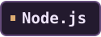
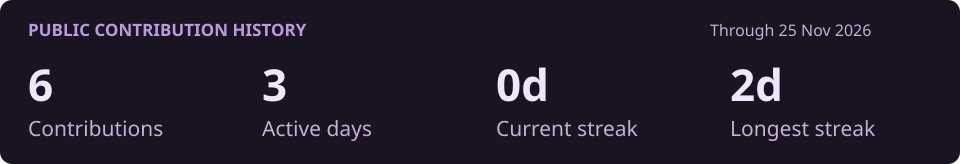
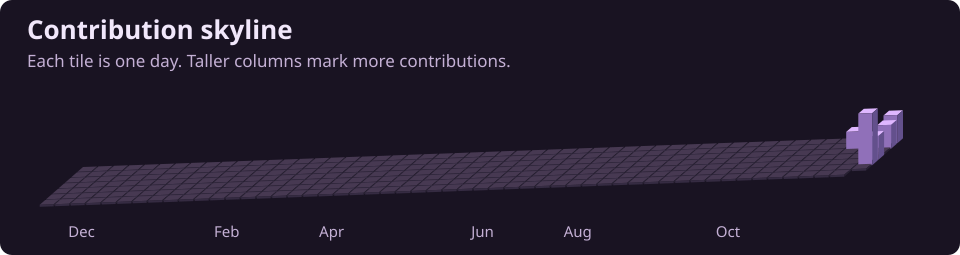

<picture>
  <source media="(prefers-reduced-motion: reduce)" srcset="./assets/hello.png">
  
</picture>

## Featured project

**DropBridge**

Send files between browsers over Wi-Fi. Pair with a password and transfer directly.

[Try it live](https://dropbridge-lime.vercel.app/) · [Source code](https://github.com/krxt-io/dropbridge)

 

## Tools I build with

**Frontend**

**Backend and data**

  

**Version control**

## What I’m exploring

- **Backend and architecture** — API design, data modeling, and where business logic belongs as a project grows.
- **Cloud and DevOps** — how applications are deployed and what it takes to keep them running.
- **Applied AI** — machine learning, generative AI, and how to evaluate a language model’s output.

## GitHub activity

REFERENCE TAKEN FROM wesleyruiz2005

Watch the contribution snake

[Browse my repositories](https://github.com/krxt-io?tab=repositories) · [View my GitHub activity](https://github.com/krxt-io?tab=overview)
