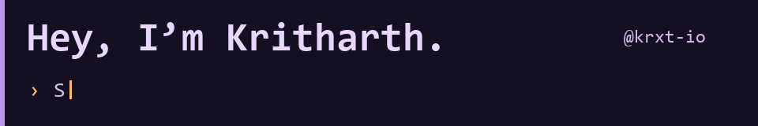

## K Kritharth Kiran Nair

I’m a software developer and MCA student at **PES University, Bengaluru**. I’ve built web projects with React, Python, and SQL. I enjoy working across the stack, but the backend is where I spend the most time. I like figuring out what an API should return, how to model the data behind it, and what happens when a request fails.

### Tools I use

- **Frontend:** React, TypeScript, JavaScript
- **Backend:** Python, FastAPI, REST APIs
- **Data:** SQL

### What I’m exploring

I’m learning about system architecture, cloud deployment, and DevOps to understand what keeps an application running after it leaves my laptop. I’m also exploring machine learning and generative AI, especially how to tell whether a language model’s answer is reliable enough for a particular task.

I enjoy hackathons because they force a team to pick the most useful part of an idea and get it working on a deadline.
