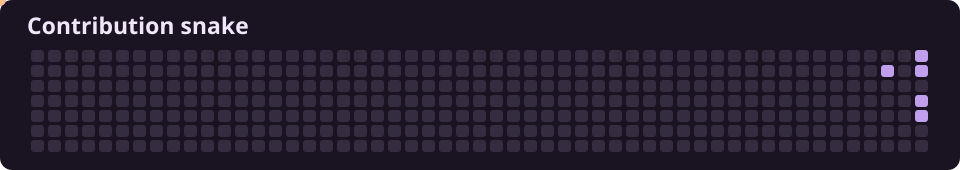

<picture>
  <source media="(prefers-reduced-motion: reduce)" srcset="./assets/hello.png">
  
</picture>

## K Kritharth Kiran Nair

**Software developer · MCA student at PES University, Bengaluru**

I build web applications with Python, React, and SQL. My projects have taken me from the interface a user sees to the API and database behind it. Backend development is the part I enjoy most, especially designing APIs that stay easy to use as an application grows.

Outside coursework, I enjoy hackathons and the challenge of getting an idea working on a deadline.

 

## Tools I build with

**Frontend**

**Backend and data**

## What I’m exploring

- **Backend and architecture** — API design, data modeling, and where business logic belongs as a project grows.
- **Cloud and DevOps** — how applications are deployed and what it takes to keep them running.
- **Applied AI** — machine learning, generative AI, and how to evaluate a language model’s output.

## GitHub activity

REFERENCE TAKEN FROM wesleyruiz2005

Watch the contribution snake

[Browse my repositories](https://github.com/krxt-io?tab=repositories) · [View my GitHub activity](https://github.com/krxt-io?tab=overview)
